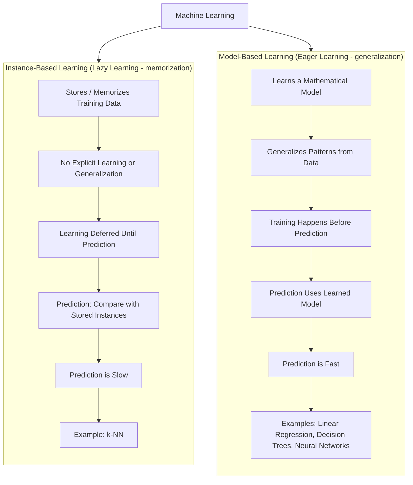

# Instance vs Model Based Learning 

## Instance-Based Learning

The system **memorizes the training examples** and generalizes to new cases by comparing them to the stored instances using a similarity measure.

**How it works:**
- Store the training data (or a representative subset)
- For a new input, find the most similar stored instance(s)
- Predict based on those neighbors (e.g., majority vote, average)

**Key characteristics:**
- No explicit "model" is built — the data *is* the model
- Prediction happens at query time (lazy learning) — training is fast/trivial, but prediction can be slow since it searches through stored data
- Needs a good similarity/distance metric (Euclidean distance, cosine similarity, etc.)
- Sensitive to irrelevant features and noisy data (since it directly compares raw examples)

**Example algorithm:** k-Nearest Neighbors (k-NN) — classify a new point based on the majority class of its *k* closest neighbors in the training set.

**Analogy:** Like solving a new problem by looking up the most similar past problem you've seen and copying/adjusting that solution.

## Model-Based Learning

The system builds a **general model** (with parameters) from the training data, then uses that model — not the raw data — to make predictions.

**How it works:**
- Choose a model architecture (linear regression, neural network, decision tree, etc.)
- Train it by optimizing parameters to fit the training data (minimizing a cost/loss function)
- Discard (or no longer need) the raw training data — the learned parameters *are* the compressed knowledge
- For new inputs, just plug values into the model equation/function

**Key characteristics:**
- Training can be slow/expensive (search for optimal parameters), but prediction is usually fast
- Generalizes via a mathematical function rather than direct comparison
- Can be more compact and often generalizes better on unseen data with less memory footprint
- Needs assumptions about the right model form (which can introduce bias if wrong)

**Example algorithms:** Linear/Logistic Regression, Decision Trees, Neural Networks, SVMs.

**Analogy:** Like learning the *underlying rule* from examples (e.g., deriving "distance = speed × time") rather than memorizing individual example problems.

## Comparison Table

| | Instance-Based | Model-Based |
|---|---|---|
| What's stored | Raw training data (or key instances) | Learned parameters/weights |
| Training time | Fast (mostly just storing data) | Slower (optimization process) |
| Prediction time | Slower (search + compare) | Fast (plug into formula) |
| Generalization | Via similarity to known examples | Via a fitted mathematical function |
| Memory usage | Grows with dataset size | Usually fixed/compact |
| Interpretability | Easy to explain individual predictions ("similar to X") | Depends on model (linear = interpretable, deep nets = black box) |
| Sensitive to | Noisy/irrelevant features, scale of data | Model assumptions, underfitting/overfitting |
| Example | k-NN, case-based reasoning | Linear regression, neural nets, decision trees |

**Practical framing:** most of the models you're probably building for your portfolio (anomaly detection, RAG-based Q&A) are model-based — anomaly detection often uses model-based approaches (e.g., isolation forests, autoencoders) rather than pure instance-based ones, though some anomaly detection techniques (like k-NN based outlier detection) *are* instance-based. Want me to connect this to which approach your anomaly detection system is using?